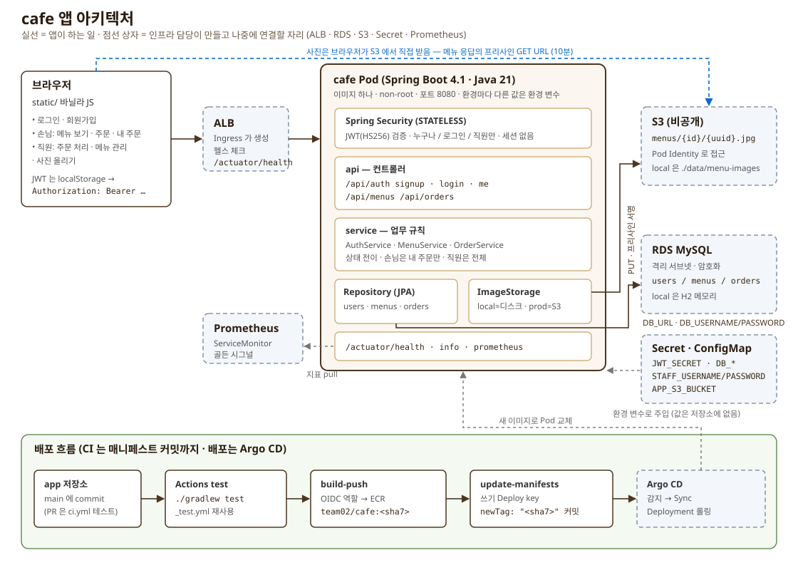

# cafe 앱 아키텍처

PNG 버전 (Notion · 발표 자료용) : [architecture.png](architecture.png)

앱 자체의 구조만 다룸. 운영 환경(인프라) 구성은 팀에서 상의 중이라 넣지 않음.

## 01. 한 줄

카페 주문 서비스. 손님은 가입해서 메뉴를 보고 주문하고, 직원은 주문을 처리하고 메뉴 · 사진을 관리함. 화면(바닐라 JS)과 API 가 **앱 하나** 에 들어 있음.

## 02. 구성

| 층 | 무엇 | 비고 |
| --- | --- | --- |
| 화면 | `static/` HTML · CSS · JS | 빌드 도구 없음 · 같은 앱이 내려줌 |
| 보안 | Spring Security · JWT(HS256) | 세션 없음 · 비밀번호는 BCrypt |
| API | `api/` 컨트롤러 | `/api/auth` · `/api/menus` · `/api/orders` — [api.md](api.md) |
| 업무 규칙 | `service/` | 상태 전이 · 권한 · 메뉴 판매 중지 — [domain.md](domain.md) |
| 저장 | JPA (`users` · `menus` · `orders`) · `ImageStorage` | DB · 사진 저장소 |
| 상태 확인 | actuator | `/actuator/health` · `info` (버전) · `prometheus` (지표) |

## 03. 프로파일

| | local (내 PC · 테스트) | prod (운영) |
| --- | --- | --- |
| DB | H2 메모리 · 끄면 사라짐 | MySQL — 연결 방식은 인프라 확정 후 |
| 사진 | `./data/menu-images` · 앱이 `/local-images/**` 로 내려줌 | 디스크 `/app/data/menu-images` (지금) — 운영 저장소는 인프라 확정 후 |
| JWT 키 · 직원 계정 | 설정 파일의 테스트 값 | 환경 변수 — [config.md](config.md) |
| 필요한 것 | JDK 21 만 | 위 값들 |

## 04. 설계 선택

| 선택 | 이유 |
| --- | --- |
| 화면을 앱 안에 (바닐라 JS) | 빌드 · 배포 대상이 앱 하나 그대로 |
| JWT · 세션 없음 | 앱이 여러 개 떠 있어도 세션 공유 없이 로그인 유지 |
| 메뉴 삭제 = 판매 중지 | 실수로 지워도 되살림 · 지난 주문이 없는 메뉴를 가리키지 않음 |
| 주문에 메뉴 이름 · 가격 복사 | 메뉴 가격이 바뀌어도 지난 주문 금액 유지 |
| 사진은 앱이 받아 검사 후 저장 | 직원만 작은 사진을 올림 · 형식 · 크기를 앱이 확인 |
| 접속 정보 · 비밀은 전부 환경 변수 | 코드 · 저장소에 주소 · 비밀이 없음 → 운영 환경이 정해지면 값만 넣으면 됨 |
